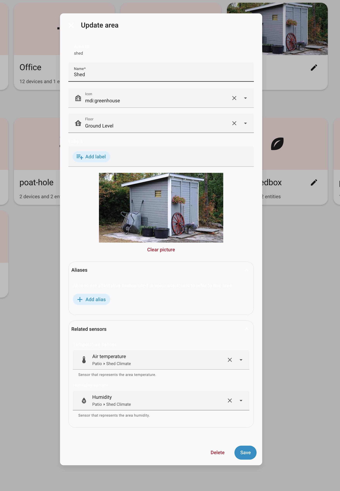

# Sensor Averaging

The card can automatically calculate and display sensor readings by device class, using the same logic as Home Assistant's area card. Most classes are averaged. Power, energy, and similar classes are totaled.

By default these sensor classes will be averaged.

- temperature
- humidity'
- illuminance

### How Averaging Works

1. **Discovery**: Finds all sensors in the area with specified device classes
2. **Filtering**: Only includes numeric sensors with valid states
3. **Grouping**: Groups sensors by unit of measurement within each device class
4. **Calculation**: Averages each group, or totals it when the device class is additive (power, energy, and similar)
5. **Display**: Shows the aggregated value with appropriate formatting

### Area Default Sensors

When an area has default temperature or humidity sensors configured (via Home Assistant's area settings), the card will:

- **Use the area's default sensors** instead of automatically collecting all sensors of that device class
- **Prevent duplicates** by skipping other temperature/humidity sensors when defaults are set
- **Display the default sensor** as part of the averaged sensors (or as a single sensor if it's the only one)

This ensures that when you've configured specific sensors as defaults for an area in Home Assistant, the card respects that choice and uses those sensors rather than averaging all sensors of that type.

**Example:**

```yaml
# Area "shed" has configured:
# temperature_entity_id: sensor.shed_climate_air_temperature
# humidity_entity_id: sensor.shed_climate_humidity

sensor_classes:
  - temperature
  - humidity
# Card will use sensor.shed_climate_air_temperature and sensor.shed_climate_humidity
# Other temperature/humidity sensors in the area will be ignored
```



### Averaging Examples

#### Temperature Sensors

```yaml
# Area has these temperature sensors:
# sensor.room_temp_1: 72.5°F
# sensor.room_temp_2: 71.8°F
# sensor.room_temp_3: 73.1°F

sensor_classes:
  - temperature
# Displays: "72.5°F" (average of the three sensors)
```

#### Power Sensors

```yaml
# Area has these power sensors:
# sensor.plug_a: 100 W
# sensor.plug_b: 500 W

sensor_classes:
  - power
# Displays: "600 W" (total of the two sensors)
```

Watts and kilowatts stay in separate groups, the same way Celsius and Fahrenheit do. The card does not convert units before adding.

These device classes are totaled instead of averaged:

- `power`, `apparent_power`, `reactive_power`
- `energy`, `reactive_energy`
- `current`, `gas`, `monetary`, `volume`, `water`

#### Mixed Units

```yaml
# Area has temperature sensors with different units:
# sensor.temp_celsius: 22.5°C
# sensor.temp_fahrenheit_1: 72°F
# sensor.temp_fahrenheit_2: 74°F

sensor_classes:
  - temperature
# Displays:
# "22.5°C" (single Celsius sensor)
# "73°F" (average of Fahrenheit sensors)
```

### Advanced Configuration

```yaml
# Complete sensor configuration
sensors:
  - sensor.special_co2_sensor # Individual sensor (shown first)
  - sensor.important_pressure # Individual sensor (shown first)
sensor_classes:
  - temperature # Averaged (shown after individual)
  - humidity # Averaged (shown after individual)
  - illuminance # Averaged (shown after individual)
  - battery
  - voltage
sensor_layout: bottom # Display location
```

### Numeric Device Classes

The following device classes are supported (must be numeric sensors). Power, energy, current, gas, water, and the other additive classes listed above are totaled. The rest are averaged:

- `temperature`, `humidity`, `pressure`, `illuminance`, `co2`, `pm25`, `pm10`, `aqi`, `battery`, `energy`, `power`, `voltage`, `current`, and more.

**Reference**: See [Home Assistant's area card documentation](https://www.home-assistant.io/dashboards/area) for the complete list.

### Climate Thresholds Integration

Individual sensors can also be used for climate thresholds, even when their device class isn't included in `sensor_classes`. This is useful when you want to:

1. **Use specific sensors** for climate calculations while excluding others
2. **Configure thresholds** without including all sensors of that device class in averaging

#### Example: Selective Climate Thresholds

```yaml
sensors:
  - sensor.living_room_temp_1 # Individual temperature sensor
  - sensor.basement_temp # Different temperature sensor
sensor_classes:
  - pressure # Only pressure sensors from area
thresholds:
  temperature:
    - entity_id: sensor.living_room_temp_1
      value: 75 # Uses living room temp only
```

In this configuration:

- `sensor.living_room_temp_1` is used for climate thresholds (if it has `device_class: temperature`)
- `sensor.basement_temp` is shown individually but not used for thresholds
- No temperature averaging occurs since `temperature` isn't in `sensor_classes`
- Pressure sensors from the area are averaged as usual

#### Threshold Lookup Priority

When `entity_id` is specified in a threshold entry, the system looks for the sensor in this order:

1. **Individual sensors** (from `config.sensors`) - if the entity has the correct device class
2. **Averaged sensors** (from `config.sensor_classes`) - as a fallback

This ensures that configured individual sensors take priority over area-wide averages for climate calculations.
